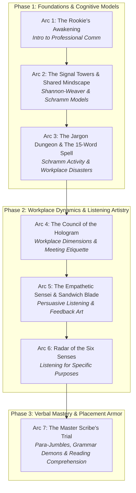
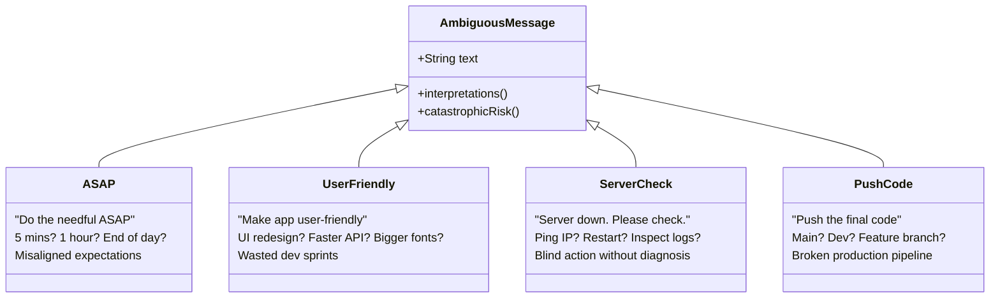
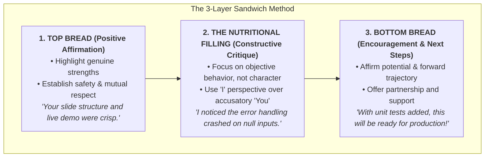
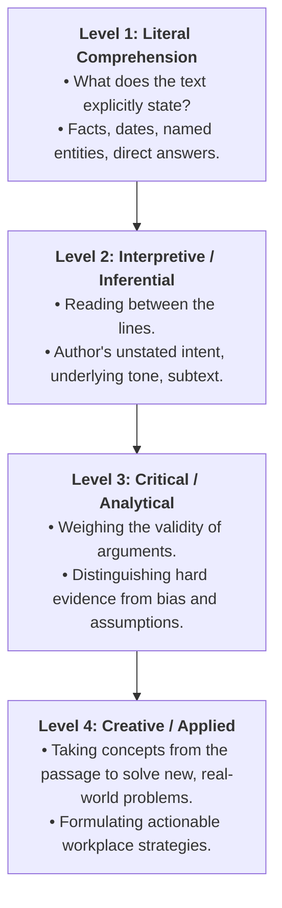

# ⚡ ADVANCED PROFESSIONAL COMMUNICATION: THE ANIME CHRONICLES
### *A Complete Course Guide & Narrative Syllabus for MCA / Professional Careers*

> **Associated Course Files:**
> - `Introduction 1.pptx`
> - `Communication (1) (1).pptx` & `Communication_Models_MCA_Simple_Examples.pptx`
> - `Communication_Activity_Schramm_MCA.pptx`
> - `Effective_Communication_in_the_Workplace.pdf`
> - `Gateways to Good Communication.pptx`
> - `Listening_as_an_Art_Persuasive_Effective_Listening (1).pptx` & `Persuasive_Effective_Listening.pptx`
> - `Listening_for_Specific_Purposes_MCA.pptx`
> - `Para_Jumbles_Error_Spotting.pptx` & `ParaJumbles_ErrorSpotting_StudentHandout.pdf`
> - `Lecture1.pptx`

---

## 🗺️ Master Curriculum Roadmap



---

# ARC 1: The Rookie's Awakening — Why Words Beat Code
*The Tale of the Two Shinobi Programmers*

```
                       ┌──────────────────────────────┐
                       │   SHINOBI CODER GUILD TRIALS │
                       └──────────────┬───────────────┘
                                      │
              ┌───────────────────────┴───────────────────────┐
              ▼                                               ▼
       [KENJI: Solo S-Rank]                           [REN: Chunin Communicator]
   • 10,000 lines/day                             • Clean, reliable code
   • Never talks in guild standups                • Shares daily crystal logs
   • Sends cryptic scrolls: "Done."              • Asks clarifying questions
   • Result: DISASTROUS COLLAPSE                  • Result: PROMOTED TO SQUAD LEADER!
```

### 📖 The Story Arc
In the high-tech ninja citadel of Neo-Edo, two apprentices joined the prestigious Software Guild of the Silicon Lotus: **Kenji** and **Ren**.

Kenji was hailed as a generational prodigy. He could weave 10,000 lines of flawless assembly code before sunrise without breaking a sweat. His algorithmic ninjutsu was legendary. Yet, during morning clan assemblies, Kenji kept his hood pulled down low, speaking to no one. When a client asked for an update on the royal treasury app, Kenji grunted and sent a one-word scroll: *"Working."* When the database caught fire, he suffered in silence, refusing to ask for guidance because he believed asking questions was a mark of weakness.

Ren, on the other hand, was an average ninja coder. He couldn't write raw machine bytecode in his sleep, but his ninja tools were clarity, poise, and empathy. Every morning at 09:00, Ren stood before the Guild Council, clearly stating his daily objectives, potential bottlenecks, and dependencies. If an elder's scroll was vague, Ren politely requested clarification before writing a single line of jutsu. When he finished an assignment, his scroll was impeccably laid out: purpose, test results, and next steps.

One year later, a high-stakes emergency struck: the Emperor needed an integrated logistics system delivered in 48 hours. Kenji locked himself in a dark tower, wrote brilliant yet incomprehensible spaghetti modules that no other ninja could link, and missed the deadline because he never asked how the authentication module worked. Ren rallied three junior clans, clearly delegated tasks, resolved cross-team blockers with calm status messages, and deployed the system on schedule.

At the annual Guild Promotion Ceremony, the Grand Master stepped onto the stage and fastened the Golden Headband of **Team Lead** not around Kenji's forehead, but around Ren's. Kenji was stunned: *"Master! My technical chakra is three times his! Why does he lead while I remain in the shadows?"*

The Grand Master looked down with serene eyes: *"In the wilderness of the real world, lone wolves die in winter. Companies do not promote lone coders who hoard knowledge; they promote leaders who connect minds."*

---

### 🔍 Concept Deconstruction & Course File Mapping

> **Mapped Course File:** `Introduction 1.pptx` (Slides 1–8)

#### 1. Technical Skills vs. Communication Skills (Slides 2–5)
*   **The Dilemma (Slide 3):** *"Which gets you promoted faster in a company? (A) Technical Knowledge, (B) Communication Skills, (C) Hard Work, (D) Networking."*
*   **The Industry Reality (Slide 4–5):** The exact slide scenario mirrors Kenji (Engineer A: brilliant programmer, never speaks, sends confusing emails) vs. Ren (Engineer B: average coder, speaks confidently, writes clear updates).
*   **Takeaway:** Technical competency gets you hired; **communication competence gets you promoted**. When you step into leadership, your output is no longer what *you* code, but what your *team* delivers through coordinated communication.

#### 2. Casual vs. Business Communication Formula (Slides 6–7)
Communication exists across many mediums (WhatsApp, Instagram, Email, Zoom, Presentations), but what makes communication **Professional**?

$$\boxed{\text{Business Communication} = \text{Information} + \text{Purpose} + \text{Professional Behaviour} + \text{Result}}$$

| Context | Informal / Casual | Professional / Business |
| :--- | :--- | :--- |
| **Example (Slide 7)** | *"Send notes."* (Peer to peer, no formal context) | *"Please share the project report before 4 PM."* |
| **Tone** | Transactional, blunt, or overly casual | Courteous, goal-oriented, structured |
| **Clarity** | Assumes the other person knows what you mean | Explicit deadline, exact deliverable |
| **Outcome** | Prone to ambiguity and resentment | Frictionless execution and accountability |

#### 3. Lost in Translation (Slide 8)
When intent and expression diverge, work grinds to a halt. In industry, every unspoken assumption is a latent defect waiting to trigger a production crash.

---

# ARC 2: The Signal Towers & The Shared Mindscape
*The Linear Transmission vs. The Domain Expansion of Wilbur Schramm*

```
SHANNON-WEAVER LINEAR MODEL (1949):
[Source] ──► [Encoder] ──► [Channel / NOISE] ──► [Decoder] ──► [Destination]
                              ▲
                 (Physical / Physiological / Semantic / Psychological)
                   *One-way broadcast; zero feedback loop!*

SCHRAMM'S INTERACTIVE LOOP (1954):
           ┌────────── Field of Experience (A) ──────────┐
           │                                             │
      ┌────▼─────────────────┐                 ┌─────────▼────────────┐
      │ Encoder / Interpreter│ ──[ Message ]──►│ Decoder / Interpreter│
      │      / Decoder       │ ◄─[Feedback ]───│      / Encoder       │
      └──────────────────────┘                 └──────────────────────┘
           │                                             │
           └────────── Field of Experience (B) ──────────┘
                  *Meaning is NEGOTIATED, not transferred!*
```

### 📖 The Story Arc
Deep in the sci-fi megacity of Neo-Kyoto, rookie operative **Cipher** was tasked with transmitting an emergency defense protocol from the central control tower to the frontline mech-pilot, **Vanguard**.

Cipher activated the old military transmission beam—the **Shannon-Weaver Array**. He keyed in the battle parameters: *"Engage auxiliary cooling immediately."* The signal fired through the troposphere, but halfway across the district, it slammed into a localized EMP storm (**Physical Noise**). Inside his cockpit, Vanguard was bleeding from a shrapnel wound (**Physiological Noise**), terrified that his squad was pinned down (**Psychological Noise**), and stared at the terminal readout displaying cryptic mainframe hex-codes (**Semantic Noise**). 

The message reached Vanguard's console as garbled text. Cipher assumed his job was finished because the telemetry showed: *Packet Sent (100%)*. He waited. No acknowledgment was built into the system. Vanguard guessed wrong, shut down the reactor core instead of the cooling bypass, and the mech suffered a catastrophic power failure!

Cipher collapsed in despair at mission control. Suddenly, the veteran cyber-tactician **Commander Schramm** laid a hand on his shoulder.

*"You treated communication like an artillery cannon, Cipher,"* Schramm scolded. *"You believed that hurling words over a wire guarantees understanding. Shannon and Weaver designed that model for telephone cables and telegraph relays in 1949! Human beings are not copper wires. We are living worlds shaped by our memories, cultures, and biases."*

Schramm activated his neural visor: *"Initiating Tactical Technique: **Field of Experience Expansion**!"*

A holographic Venn diagram expanded in the air. Two glowing rings slowly drifted toward each other. 
*"The left circle is your technical mind, Cipher—filled with Git trees, kernel calls, and microservices. The right circle is Vanguard's reality—heat signatures, ammunition counts, and survival. Where your two circles do not overlap, misunderstanding rules. You told a frontline pilot to 'engage auxiliary cooling' without explaining that it meant 'pull the blue lever under your right knee'! To communicate, you must encode your message using symbols that live inside HIS Field of Experience, and you must demand a continuous Feedback Echo before you celebrate victory!"*

---

### 🔍 Concept Deconstruction & Course File Mapping

> **Mapped Course Files:** `Communication (1) (1).pptx` (Slides 1–35) & `Communication_Models_MCA_Simple_Examples.pptx` (Slides 1–35)

#### 1. The Shannon–Weaver Linear Model (1949) (Slides 4–14)
*   **Origin:** Developed by Claude Shannon & Warren Weaver for Bell Telephone Company. Designed to solve mathematical transmission efficiency in telephone/telegraph lines, later adapted into human social psychology.
*   **The 5 Linear Components (Slides 6–10):**
    1.  **Information Source:** The originator who conceives the idea.
    2.  **Transmitter / Encoder:** Converts message into signals/words.
    3.  **Channel:** The physical medium (airwaves, copper cables, chat platforms).
    4.  **Receiver / Decoder:** Reconstructs the signal into understandable thoughts.
    5.  **Destination:** The mind of the final recipient.
*   **The 4 Deadly Types of Noise (Slide 9):**
    *   *Physical Noise:* Static on phone line, loud cafe background, microphone buzzing on Teams.
    *   *Physiological Noise:* Headaches, exhaustion, hearing impairment, hunger.
    *   *Semantic Noise:* Heavy technical jargon, ambiguous words ("ASAP", "Soon"), words with multiple cultural meanings.
    *   *Psychological Noise:* Preconceptions, anger, anxiety, mistrust, ego.
*   **Fatal Limitations (Slides 13–14):**
    *   Strictly **one-way**: No feedback mechanism.
    *   Treats humans as passive signal terminals; ignores emotions, social context, and power hierarchies.
    *   Cannot detect deception or non-verbal nuances.

#### 2. Wilbur Schramm’s Interactive Model (1954) (Slides 15–35)
*   **Wilbur Schramm:** Celebrated as the *"Father of Communication Studies."* He broke the linear paradigm by establishing that communication is **two-way, cyclical, and interactive**.
*   **Core Pillars (Slides 18–21):**
    1.  **Encoder–Interpreter–Decoder (E–I–D):** Every participant acts as both sender and receiver simultaneously. We don't just passively decode; we *interpret* through our cognitive filters.
    2.  **Feedback Loop:** The receiver's reaction becomes a new message sent back to the original sender. Communication is not a one-time shot; it is an ongoing cycle.
    3.  **Field of Experience ($FoE$):** The sum total of an individual's cultural upbringing, education, technical knowledge, life history, and workplace experiences.
*   **The Crucial Golden Rule (Slide 23):**
    $$\text{Shared Understanding} \propto (\text{Field of Experience}_A \cap \text{Field of Experience}_B)$$
    *If the overlap is zero, communication is impossible. If the overlap is small, miscommunication is guaranteed.*
*   **The Developer vs. Client Classic Paradox (Slide 25):**
    *   *Developer says:* "The architecture is scalable." (Thinking: decoupled microservices, Kubernetes autoscaling, low latency).
    *   *Client hears:* "Will the website crash when 10,000 customers hit the checkout button on Diwali?"
    *   *Professional Translation:* Instead of spitting jargon, expand the shared field: *"We designed this so that when your traffic multiplies tenfold during sales, the system automatically expands without slowing down."*

#### 3. Limitations & Realities of Schramm's Model (Slides 27–31)
*   **Assumes Equality:** Fails to account for **Power Hierarchies**. A junior engineer or intern will often nod silently even when completely confused because questioning a senior manager feels culturally or professionally risky.
*   **Blind to Deception & Emotional Arousal:** Ignores strategic manipulation (office politics, impression management) and the fact that intense anger or panic distorts rational encoding and decoding.

---

# ARC 3: The Jargon Dungeon & The 15-Word Spell
*The Communication Disaster Challenge*

```
                       ┌───────────────────────────────┐
                       │ THE CASCADING GIT CATASTROPHE │
                       └──────────────┬────────────────┘
                                      │
            Manager: "Please push the final code ASAP." (Vague command)
                                      │
                                      ▼
            Rookie: Pushes untested experimental build to 'MAIN' branch
                                      │
                                      ▼
                      Main CI/CD Pipeline EXPLODES! 💥
                                      │
                                      ▼
             Broken build ──► Downtime ──► Angry Enterprise Client!
```

### 📖 The Story Arc
At the digital engineering garrison of Neo-Tokyo, the dreaded **Lord Buzzword** ruled the upper management chambers. Lord Buzzword never gave clear technical parameters; instead, he hurled cryptic curses into the team's Slack channels.

One fateful Friday at 3:30 PM, Lord Buzzword fired three rapid-fire scrolls into the rookie squad room:
1. *"Do the needful ASAP."*
2. *"Make the payment gateway more user-friendly."*
3. *"The production cluster is behaving strangely. Please check."*
4. *"Please push the final code."*

The rookies froze in sheer terror. 
Rookie Taro muttered: *"What does 'ASAP' mean?! Does it mean drop my lunch right now? Does it mean by 5 PM? Does it mean next Monday?"*
Rookie Sakura panicked: *"Make it user-friendly?! Should I recolor the checkout button pink? Should I remove two-factor authentication? Should I rewrite the UI in React?!"*
Rookie Daiki stared at the fourth message: *"Push the final code? Where?! Main branch? Dev branch? Staging? GitHub? GitLab?!"*

Terrified of looking foolish by asking questions, Daiki committed his raw, half-tested code straight into the `main` production branch and pushed to production. 

**KABOOM!** The continuous deployment pipeline shattered. The core banking server went pitch black. Alerts flashed crimson across the citadel. Three enterprise clients called the CEO screaming in fury. A simple ambiguity had metastasized into a half-million-dollar technical disaster!

From the smoke emerged **Architect Maya**, carrying the glowing **Tablet of Clarity**.
*"Fools!"* she cried. *"You allowed ambiguity to corrupt your chakra! Schramm warned us that when instructions lack context, human minds invent their own conflicting interpretations. A communication failure always breeds a technical catastrophe!"*

Maya drew her stylus and carved the legendary **15-Word Managerial Spell** onto the glass:
> **$\boxed{\text{WHO} + \text{WHAT} + \text{WHERE} + \text{WHEN}}$**

*"Behold the antidote to Lord Buzzword!"* Maya declared.
Instead of: *'Please do the needful ASAP'* (Ambiguity Level: 100%),
Cast the Spell:
$$\text{“Taro: test login module and push to 'dev' branch before 4 PM today.”}$$
*Total word count: 14 words. Ambiguity: ZERO.*

She turned to the rookies who were accustomed to sending one-word slacker replies: *"And hear this! The next person who replies to an executive instruction with 'Done.', 'Will see.', 'Can't.', 'Sir, what?', or 'Bro, I have a doubt' shall be stripped of their git privileges forever. Professional communication requires context, precision, and respectful clarity!"*

---

### 🔍 Concept Deconstruction & Course File Mapping

> **Mapped Course File:** `Communication_Activity_Schramm_MCA.pptx` (Slides 1–16)

#### 1. Deconstructing the 4 Ambiguous Workplace Disasters



*   **Message 1: "Do the needful ASAP" (Slides 3–4):**
    *   *The Trap:* "Do the needful" is archaic Victorian-era Indian English that specifies no action; "ASAP" provides zero measurable timestamp.
    *   *Takeaway:* Always define the exact verb and an explicit calendar deadline (e.g., *"by 4:00 PM IST"*).
*   **Message 2: "Make the app more user-friendly" (Slides 5–6):**
    *   *The Trap:* Every developer, designer, and client has a wildly different *Field of Experience*. A backend dev thinks caching makes it user-friendly; a UI designer thinks rounded buttons do; a product manager thinks fewer form fields do.
*   **Message 3: "The server is down. Please check." (Slides 7–8):**
    *   *The Trap:* Does "check" mean ping the IP? Read error logs? Reboot the machine? Call AWS support?
    *   *Pro Tip:* Never act blindly on vague instructions. Ask a structured clarifying question: *"Understood. Shall I review the Nginx error logs, or do you want me to restart the staging container?"*
*   **Message 4: "Please push the final code" (Slides 9–10):**
    *   *The Cost:* Wrong branch $\to$ broken build $\to$ delayed release $\to$ lost revenue.

#### 2. The 15-Word Manager Challenge (Slides 11–13)
*   **The Framework:** Every professional directive must answer 4 variables:
    1.  **WHO:** Explicit assignee.
    2.  **WHAT:** The discrete, measurable task.
    3.  **WHERE:** The exact environment/branch/folder.
    4.  **WHEN:** The exact cutoff hour.
*   **Example (Slide 13):**
    *   ❌ Unclear: *"Please do the needful ASAP."*
    *   ✅ Clear (14 words): *"Complete and test the login page; push it to the development branch by 4 PM today."*

#### 3. The "Worst Email" Hall of Shame (Slide 14)
Why are these messages career poison in corporate environments?
*   *"Done."* $\to$ Too curt; conveys passive aggression or disinterest. No reference to what was verified or where deliverables reside.
*   *"Will see."* $\to$ Lacks accountability; suggests the task is optional.
*   *"Can't."* $\to$ Defeatist and unprofessional. Offer alternative solutions or constraints instead: *"I cannot complete this by 3 PM due to the sprint release, but I can deliver it by 11 AM tomorrow."*
*   *"Sir, what?"* $\to$ Informal, jarring, and disrespectful of the professional hierarchy.
*   *"Bro, I have a doubt."* $\to$ Colloquial campus slang. Never use "Bro" with colleagues or managers; use *"Hi [Name], I have a question regarding the API contract."*

---

# ARC 4: The Council of the Hologram
*The Gateways to Communication & Meeting Etiquettes*

```
                 THE TRIAD OF WORKPLACE REALITY (PDF Page 4)
                 ┌─────────────────────────────────────────┐
                 │  Message 1: What the speaker SAID       │
                 │  Message 2: What the speaker MEANT      │
                 │  Message 3: What the listener HEARD     │
                 └─────────────────────────────────────────┘
                                      │
     When all three align ────────────┴──────────► PERFECT HARMONY
     When they diverge    ───────────────────────► CHAOS & DISPUTES
```

### 📖 The Story Arc
Inside the orbital conference station of the Tech-Federation, the Quarterly Sprint Council was underway. Ten holographic avatars sat around the floating circular table. 

Rookie engineer **Kai** was sweating through his suit. This was his very first corporate deployment meeting. Within ten minutes, the council disintegrated into utter anarchy:
*   At 10:00 AM, the meeting link failed. At 10:02 AM, Senior Dev Vane yelled: *"Can you hear me?!"* At 10:04 AM, his mic was on mute. At 10:06 AM, someone's dog barked while a tea vendor shouted in the background (**The Online Meeting Disaster**).
*   When Project Director Linda presented the architecture timeline, Architect Boris suddenly cut her off: *"No, that's completely wrong! I already know what happened!"* Boris seized the microphone and talked non-stop for twenty-five minutes about his pet database project, completely blocking anyone else from speaking (**Meeting Hijacking**).
*   When the discussion touched on server costs, two engineers started passionately arguing about which brand of coffee the breakroom should order (**Losing the Agenda**).
*   In the meeting chat room, someone asked: *"Will the patch be ready by Friday?"* Senior Dev Vane simply typed: *"Fine."* Every person reading the screen froze. Did *Fine.* mean *"Yes, everything is on track"*? Did it mean *"I'm furious with this team and giving up"*? Or did it mean *"Whatever, I don't care"*?

Watching the trainwreck, **High Arbiter Shweta** slammed her gavel on the holographic dais. The chamber silenced.

*"Initiate the Protocol of the Five Gateways!"* she commanded. 
Her holographic eyes locked onto Kai: *"A meeting is not an open lounge to vent your stream of consciousness. It is a strategic ritual to exchange data, make decisions, and coordinate battle forces. Every time you speak, three messages exist: what you said, what you meant, and what the world heard. If you fail to prepare your microphone, your agenda, and your note-taking scroll, you steal the company's most precious asset: collective time!"*

She drew forth the sacred parchment of **D.A.R.D.** and handed it to Kai: *"Henceforth, you will document every gathering not with rambling prose, but with the Four Pillars of Action!"*

---

### 🔍 Concept Deconstruction & Course File Mapping

> **Mapped Course Files:** `Gateways to Good Communication.pptx` (Slides 1–33) & `Effective_Communication_in_the_Workplace.pdf` (Pages 1–32)

#### 1. The Three Messages Phenomenon (PDF Page 4)
Whenever human beings converse, three distinct messages are created:
1.  **What you said:** The literal acoustic words spoken.
2.  **What you meant:** Your internal thought, emotional state, and subconscious intent.
3.  **What the listener heard:** The message filtered through the receiver's biases, insecurities, and assumptions.

#### 2. Meeting Etiquette: Rules of Engagement (PPTX Slides 4–17)
*   **The 5-Minute Pre-Meeting Check (Slide 7):**
    *   Test mic, camera, headphones, network bandwidth, and presentation files *before* the meeting starts.
    *   Poor preparation: Joining at 10:02 saying *"Can you hear me?"* and searching for slide decks at 10:06.
*   **Tactful Turn-Taking & Reframing Disagreements (Slides 9–12):**

| Raw / Unprofessional Expression | Professional, High-Impact Reframing |
| :--- | :--- |
| *"No, that's wrong!"* (Slide 10) | *"I have a slightly different view. May I explain why?"* |
| *"You didn't understand what I said!"* (Slide 10) | *"Let me explain that part again from another perspective so we are on the same page."* |
| *"This idea won't work."* (Slide 11–12) | *"I see the potential in this approach, but I have some concerns regarding its implementation and cost."* |
| *"You're interrupting me!"* | *"If I could just finish this thought, I’ll be glad to open the floor for your input."* |

*   **Taming the "Meeting Hijacker" (Slide 13):** A meeting hijacker talks excessively, changes the topic, answers every question, and suffocates team input. 
    *   *Countermeasure (Slide 14):* Intervene politely: *"That is a very valuable point, Boris; let us park that in the backlog and return to our scheduled agenda item on the project deadline."*
*   **The D.A.R.D. Note-Taking Framework (Slide 16):**
    Never leave a meeting with vague feelings. Document the **Four Pillars**:
    $$\boxed{\begin{aligned}
    \mathbf{D} &\text{ecision: What was formally decided?} \\
    \mathbf{A} &\text{ction: What concrete task must be executed?} \\
    \mathbf{R} &\text{esponsibility: Exactly WHO owns this task?} \\
    \mathbf{D} &\text{eadline: By what exact date and hour?}
    \end{aligned}}$$
    *Example:* Decision: Adopt revised payment UI. Action: Build React mockups. Responsibility: Riya. Deadline: Thursday, 4:00 PM.

#### 3. Remote Communication & The Chat Traps (Slides 18–29)
*   **The Death of Non-Verbal Cues (Slide 23):** Face-to-face dialogue provides facial micro-expressions, posture, eye contact, and tone. Text chat strips 90% of these emotional signals away.
*   **The Ambiguity of "Fine." (Slide 24):** In workplace text, short messages trigger anxiety. "Fine." can be interpreted as approval, passive-aggressive annoyance, or apathy.
*   **The Anti-Patterns of Workplace Chat (Slide 25):**
    *   ❌ The "Naked Hi": Sending *"Hi"* ... waiting 5 minutes ... *"Are you there?"* ... waiting 10 minutes ... *"I had a question."* (This steals time and forces useless ping-pong).
    *   ✅ The Single Comprehensive Dispatch: *"Hi Rahul, could you please share the sprint testing report by 3 PM today? I need it for the client review."*
*   **The 4 Questions Before Hitting Send (Slide 26):**
    1.  **CLEAR:** Will the reader understand my exact intent without guessing?
    2.  **COMPLETE:** Did I include the links, files, and background context?
    3.  **CONCISE:** Can I delete filler words without losing meaning?
    4.  **COURTEOUS:** Is the tone respectful, constructive, and free of passive aggression?

---

# ARC 5: The Empathetic Sensei & The Sandwich Blade
*The Art of Persuasive Listening & Constructive Feedback*

```
                      THE FEEDBACK SANDWICH TECHNIQUE
                     ┌───────────────────────────────┐
                     │   TOP BREAD: Genuine Praise   │  ◄── Set psychological safety
                     ├───────────────────────────────┤
                     │   FILLING: Specific Critique  │  ◄── Focus on BEHAVIOR, not person
                     ├───────────────────────────────┤
                     │ BOTTOM BREAD: Encouragement   │  ◄── Future-focused empowerment
                     └───────────────────────────────┘
```

### 📖 The Story Arc
In the Mountain Dojo of Verbal Arts, apprentice warrior **Aoi** challenged her squadmate **Tetsuo** after a failed mission.

*"Tetsuo, your battle pitch was awful!"* Aoi snapped. *"You're lazy, your slides were unreadable, and you made our entire clan look like amateurs!"*
Tetsuo's face flushed crimson with rage. His fists clenched. His defensive barrier snapped into place: *"Oh yeah?! At least I spoke up! You just sat there like a mute stone! You have no right to judge me!"*

The two apprentices were on the verge of drawing blades when **Sensei Verma** stepped between them with a wooden staff. With a swift flick, she disarmed both students.

*"Fools,"* Sensei Verma said softly. *"Aoi, you struck Tetsuo's ego, not his technique. When you attack a person's character, their biological instinct is fight-or-flight. Their ears slam shut, their mind prepares a counter-attack, and no learning takes place. Most warriors do not listen to understand; they listen only with the intent to reply!"*

Sensei Verma sat cross-legged on the tatami mat. *"Hear this: Hearing is mere physiology—sound waves bouncing off your eardrum like rain on a roof. But **Listening is an Art**—an act of active cognitive courage and emotional discipline. If you wish to correct a fellow warrior, you must forge the legendary **Sandwich Blade**."*

The Sensei demonstrated the three layers of the ancient technique:
1.  **The Top Bread (Praise):** First, establish trust and psychological safety. Acknowledge what the warrior did well.
2.  **The Savory Filling (Actionable Critique):** Deliver the correction. Focus strictly on *specific behaviors and data*, never on personality. Use *"I"* statements instead of accusatory *"You"* statements.
3.  **The Bottom Bread (Empowerment):** Close with encouragement and confidence in their future victory.

She turned to Aoi: *"Now, sheathe your daggers. Feed Tetsuo the Sandwich."*

Aoi took a deep breath, centered her chakra, and spoke:
*(Top Bread)*: *"Tetsuo, your opening story about the user journey caught everyone's attention, and your product vision was inspiring."*
*(The Filling)*: *"However, when presenting the financial charts, the fonts were too small to read from the back row, and I felt the transition between pricing tiers lacked clarity."*
*(Bottom Bread)*: *"With your natural charisma and slide structure, if we bump up the font sizes and add a comparison table, our next pitch to the Council will be unstoppable."*

Tetsuo's defensive walls melted away. He bowed deeply: *"Thank you, Aoi. I will fix the charts tonight."*

---

### 🔍 Concept Deconstruction & Course File Mapping

> **Mapped Course Files:** `Listening_as_an_Art_Persuasive_Effective_Listening (1).pptx` (Slides 1–18) & `Persuasive_Effective_Listening.pptx` (Slides 1–24)

#### 1. Hearing vs. Listening (Slides 2–3)
*   **Hearing:** A passive, involuntary physiological process where auditory sound waves vibrate the eardrum and are transmitted to the auditory cortex. Requires zero conscious effort.
*   **Listening:** A voluntary, active cognitive and psychological process requiring interpretation, evaluation, empathy, and response.
*   **The Famous Maxim (Slide 2):** *“Most people do not listen with the intent to understand; they listen with the intent to reply.”* – Stephen R. Covey.

#### 2. What is Persuasive Listening? (Slides 4–10)
*   **Core Paradox:** To persuade someone, you must first let *them* persuade you that they have been heard. Listening builds **rapport, trust, and psychological safety**.
*   **The 4 Core Skills of Persuasive Listening (Slide 7):**
    1.  **Ask Relevant Questions:** Ask open-ended questions to uncover real underlying concerns rather than surface symptoms.
    2.  **Clarify and Paraphrase:** Restate their point in your own words: *"What I'm hearing is that you're concerned about testing deadlines, is that correct?"*
    3.  **Maintain Open Body Language:** Uncrossed arms, leaning slightly forward, steady eye contact, nodding.
    4.  **Empathy:** Seeking to comprehend their emotional frame of reference without immediate judgment.

#### 3. The Sandwich Method for Constructive Feedback (Slides 9–11, 16–17)



*   **Golden Rule for Feedback (Slide 9):**
    *   Be **specific**, not vague (*"The font size on Slide 4 was 12pt"* vs *"Your slides look bad"*).
    *   Focus on **behavior**, not personality (*"You were late to three standups"* vs *"You are irresponsible"*).
    *   Use **"I" statements** instead of **"You" accusations** (*"I felt confused during the architecture overview"* vs *"You explained it terribly"*).

#### 4. Receiving Feedback Professionally (Slide 12, 17)
*   Do **NOT** interrupt or formulate defense arguments while the other person is speaking.
*   Separate feedback about your *work* from your *self-worth* (Your code is not your identity).
*   Ask clarifying questions: *"Could you give me an example of where my documentation was unclear?"*
*   Express gratitude: *"Thank you for pointing that out; that helps me improve."*

---

# ARC 6: Radar of the Six Senses
*Listening for Specific Purposes in Technical Environments*

```
                       ┌───────────────────────────────┐
                       │  THE 6 RADAR FREQUENCIES OF   │
                       │   TECHNICAL LISTENING (MCA)   │
                       └──────────────┬────────────────┘
                                      │
        ┌──────────────┬──────────────┼──────────────┬──────────────┐
        ▼              ▼              ▼              ▼              ▼
  [Discriminative] [Comprehensive] [Critical]   [Empathetic]   [Selective]
  • Voice timbre   • System flow  • Feasibility • Burnout      • Deadlines &
  • Urgency tones  • Data logic   • Stress-test • Frustration    budgets only
```

### 📖 The Story Arc
Inside the cockpit of the colossal defense mecha *Titan-MCA*, Pilot **Ryu** sat surrounded by twenty holographic displays. Outside, an orbital ion storm roared.

Through his neural headset poured a barrage of auditory signals:
*   Frequency 1: The AI automated computer drone reciting telemetry: *"Oxygen 98%, pressure nominal, fuel pump beta at 400 Kelvin..."*
*   Frequency 2: Commander Shweta's voice crackling over the priority channel: *"Ryu! The core shield generator must be synchronized by 04:00 hours!"*
*   Frequency 3: Junior engineer Nami sobbing softly on the private debug channel: *"I've rewritten this tracking loop six times and it's still throwing null pointer errors... I can't do this anymore..."*
*   Frequency 4: Corporate contractor Mr. Sterling pitching a new experimental thruster mod over the trade channel: *"This module guarantees 400% thrust, no drawbacks at all!"*

Ryu's brain began to overheat. If he listened to every word with equal intensity, his cognitive bandwidth would collapse!

Suddenly, his internal mentor, the **Digital Sage**, activated within his subconscious:
*"Ryu! Switch from general hearing to **Specific Purpose Listening**! Tune your neural radar into the **Six Tactical Frequencies**!"*

Ryu adjusted his cognitive dials:
1.  **Discriminative Frequency:** He filtered the multi-speaker chaos, instantly recognizing the sharp, urgent timbre of Commander Shweta's voice above the background hum of the automated computer.
2.  **Comprehensive Frequency:** When the chief engineer explained how the auxiliary fuel routing connected to the main cooling manifold, Ryu visualized the complete logic flow of the architecture without missing a single valve connection.
3.  **Critical / Evaluative Frequency:** When contractor Sterling hyped his magic thruster, Ryu's critical radar engaged: *Is this scientifically feasible? Where are the thermal dissipation numbers? This contractor is hiding heat risks!*
4.  **Empathetic Frequency:** He switched to Nami's channel. He didn't offer cold algorithmic advice; he offered emotional resonance: *"Take a breath, Nami. You've been coding for 14 hours straight. Step back for ten minutes. We will fix the bug together."*
5.  **Selective Frequency:** Amidst Commander Shweta's 10-minute battle briefing, Ryu's mental filter swept past the atmospheric descriptions and locked onto the two vital targets: **Action Item: Synchronize Shield** | **Deadline: 04:00 Hours**.

With his specialized radar engaged, Ryu eliminated cognitive overload, executed the exact orders, saved his teammate from burnout, and guided the Titan to victory!

---

### 🔍 Concept Deconstruction & Course File Mapping

> **Mapped Course File:** `Listening_for_Specific_Purposes_MCA.pptx` (Slides 1–10)

#### 1. The Core Meaning of Specific Purpose Listening (Slides 2–3)
Listening is not an all-or-nothing sensory sponge. Specific Purpose Listening means **listening with a predefined cognitive objective** to filter out irrelevant noise, prevent information overload, and extract high-value intelligence.

#### 2. The 6 Core Types of Listening (Slide 4)

| Listening Type | Technical / MCA Real-World Definition | Workplace Scenario |
| :--- | :--- | :--- |
| **1. Discriminative** | Distinguishing between different sounds, vocal timbres, pitches, and emotional undertones. | Identifying who is speaking in a 15-person remote Teams call without looking at the screen; detecting urgency in a client's voice. |
| **2. Comprehensive** | Listening to understand the systemic relationships and logical architecture of complex concepts. | Following a senior architect's lecture on distributed microservices and database sharding. |
| **3. Critical / Evaluative**| Analyzing, weighing, and judging the validity, logic, and feasibility of an argument. | Evaluating a vendor's project proposal to decide whether the promised deliverables are technically realistic. |
| **4. Appreciative** | Listening for personal enjoyment, aesthetic pleasure, or intellectual stimulation. | Listening to a tech podcast (e.g., Lex Fridman interviewing Guido van Rossum) or an inspirational keynote. |
| **5. Empathetic** | Providing a supportive, judgment-free space to understand someone’s emotional pain or frustration. | Listening to a teammate vent about a painful debugging session or personal burnout without immediately lecturing them. |
| **6. Selective** | Scanning continuous speech specifically to capture targeted data points while tuning out filler. | Listening during a 1-hour corporate town hall strictly for announcements regarding project deadlines or appraisal bonuses. |

#### 3. The 4 Operational Modes of Listening (Slide 5)
*   **Listening for Gist:** Grasping the high-level macro-concept or main theme (e.g., *"The client wants to migrate to the cloud"*).
*   **Listening for Specific Information:** Hunting for concrete dates, numbers, financial figures, or names (e.g., *"Migration date: October 15; Budget: \$50k"*).
*   **Listening for Detailed Understanding:** Following complex, sequential instructions (e.g., deployment runbooks or disaster recovery protocols).
*   **Listening for Inference:** Decoding implied, unstated intentions between the lines (e.g., when a client says *"We're happy with the design, but our investors are nervous about timelines"*, they mean *"Ship it faster or we cancel"*).

#### 4. The 5-Step Tactical Strategy (Slides 6–9)
$$\boxed{\text{Know Purpose} \longrightarrow \text{Predict Information} \longrightarrow \text{Focus on Keywords} \longrightarrow \text{Mind-Map Notes} \longrightarrow \text{Review \& Confirm}}$$

---

# ARC 7: The Master Scribe's Trial
*Para-Jumbles, Grammar Beasts & The Four Levels of Reading*

```
                       ┌───────────────────────────────┐
                       │  THE IMPERIAL SCRIBE'S EXAM   │
                       └──────────────┬────────────────┘
                                      │
              ┌───────────────────────┴───────────────────────┐
              ▼                                               ▼
     [PART A: PARA-JUMBLES]                         [PART B: ERROR SPOTTING]
  • Rule 1: Find Opening Anchor                  • Demon 1: The 'Each of' Trap
  • Rule 2: Follow Reference Pronouns            • Demon 2: Since vs For
  • Rule 3: Mandatory Pairs & Connectors         • Demon 3: Although vs But
  • Rule 4: Acronym Expansion Order             • Demon 4: Neither...Nor Proximity
  • Rule 5: Odd Sentence Out (The Rogue)         • Demon 5: Latin Comparatives (+TO)
```

### 📖 The Story Arc
To enter the sacred ranks of the **Grand Architects of the Written Code**, young scholar **Ren** was forced to enter the Labyrinth of the Master Scribe. 

In the first chamber, four shattered stone tablets hovered in mid-air, their order scrambled by ancient chaos.
The guardian sphinx bellowed: *"Restore the flow of history, or remain trapped forever!"*

```
[Tablet A]: This has led to rapid urbanization and migration.
[Tablet B]: Cities today are growing at an unprecedented pace.
[Tablet C]: However, it has also created challenges like overcrowding and pollution.
[Tablet D]: The main reason is better employment opportunities in cities.
```

Ren remained calm. He recalled the **Scribe's Para-Jumble Algorithmic Scrolls**:
*   *Step 1: Locate the Root Anchor (Opening Sentence).* Tablet A begins with *"This has led..."*—a dependent pronoun pointer. Tablet C begins with *"However..."*—a contrast signal. Tablet D begins with *"The main reason..."*—a cause pointer. Only **Tablet B** introduces an independent, universal noun: *"Cities today are growing at an unprecedented pace."* Tablet B is the Opening Anchor!
*   *Step 2: Trace the Mandatory Pair.* Why are cities growing? Tablet D explains: *"The main reason is better employment opportunities..."* So, **B $\to$ D** is an unbreakable pair!
*   *Step 3: Track the Consequence and Contrast.* What does employment lead to? Tablet A: *"This has led to rapid urbanization and migration."* Finally, Tablet C presents the counter-balancing reality: *"However, it has also created challenges..."*
*   *The Sequence Unlocks:* **B $\longrightarrow$ D $\longrightarrow$ A $\longrightarrow$ C!** 
The stone door swung open!

In the second chamber, five monstrous Grammar Beasts guarded the treasure chest. Each beast bore a corrupted sentence on its chest.
The Sphinx snarled: *"To slay the beasts, you cannot simply guess what 'sounds weird'! You must declare the EXACT LAW OF GRAMMAR that each beast has broken!"*

*   **Beast 1:** *"Each of the candidates have submitted their documents..."*
    Ren drew his sword: *"Demon of the 'Each' Trap! The phrase 'of the candidates' is a prepositional distractor! The true subject is 'Each', which is singular! The verb must be **HAS submitted**!"* The beast dissolved into mist!
*   **Beast 2:** *"She has been working in this company since three years..."*
    Ren struck again: *"'Since' demands an exact starting point in time! For an accumulated span of duration, the sacred word is **FOR three years**!"* The beast shattered!
*   **Beast 3:** *"Neither the coach nor the captain were present..."*
    Ren chanted: *"The Rule of Proximity! In a 'Neither... Nor' pairing, the verb must bow to the subject closest to its blade! 'The captain' is singular! The verb must be **WAS present**!"* The third beast collapsed!
*   **Beast 4:** *"Although he studied hard, but he could not clear the exam..."*
    Ren slashed: *"The Double-Dip Curse! 'Although' already establishes the contrast! Pairing it with 'but' is redundant heresy! Banish 'but'!"*
*   **Beast 5:** *"She is junior than me in this office..."*
    Ren delivered the final blow: *"The Latin Comparative! Junior, Senior, Superior, and Inferior reject 'than' and demand the preposition **TO**! She is **junior to me**!"*

Silence fell over the labyrinth. The Sphinx bowed low. Ren had mastered the art of verbal reasoning and syntactic precision.

---

### 🔍 Concept Deconstruction & Course File Mapping

> **Mapped Course Files:** `Para_Jumbles_Error_Spotting.pptx` (Slides 1–20), `ParaJumbles_ErrorSpotting_StudentHandout.pdf` (Pages 1–2), & `Lecture1.pptx` (Slides 1–39)

#### 1. Para-Jumbles: The 4 Golden Rules (PPTX Slides 3–8)
1.  **Rule 1: Find the Opening Sentence (Slide 4)**
    *   Must be **independent**; introduces the overarching subject without relying on prior knowledge.
    *   *Elimination Strategy:* Reject sentences starting with pronouns (*he, she, it, they, this, these*), contrast words (*however, but, nevertheless*), or conclusion words (*therefore, thus, finally*).
2.  **Rule 2: Follow Reference Words (Slide 5)**
    *   Demonstrative pronouns (*this, that, these, those*) and definite articles (*the*) point back to a noun introduced in an earlier sentence.
3.  **Rule 3: Identify Sequencing and Contrast Signals (Slide 6)**
    *   *Chronology:* First $\to$ Next $\to$ Soon after $\to$ Finally.
    *   *Contrast:* On one hand / On the other hand; Although; However.
    *   *Cause & Effect:* Because $\to$ As a result $\to$ Consequently $\to$ Therefore.
4.  **Rule 4: Acronym Expansion Rule**
    *   The full organizational title or name is always stated *before* its acronym is used (e.g., *Indian Space Research Organisation (ISRO)* precedes *ISRO*).

#### 2. The Odd Sentence Out Technique (Slide 9)
*   **The Skill:** Identifying the rogue sentence that disrupts thematic unity.
*   **Worksheet Walkthrough (Q3):**
    *   *(A) Climate change has caused unpredictable weather.*
    *   *(B) Rising sea levels threaten coastal cities.*
    *   *(C) Many countries are working towards renewable energy.*
    *   *(D) Cricket is the most popular sport in India.*
    *   *Analysis:* Sentences A, B, and C share an environmental sustainability theme. Sentence D is grammatically flawless, but it destroys **coherence**. Therefore, **D is the Odd Sentence Out**.

#### 3. Error Spotting: The 5 High-Frequency Exam Rules (Handout & PPTX Slides 10–18)

| Question # | Flawed Sentence | Grammatical Rule Violated | Correction & Justification |
| :--- | :--- | :--- | :--- |
| **Q6** | *Each of the candidates **have submitted** (a)...* | **Subject-Verb Agreement ("Each" Trap)** | **have $\to$ has**. "Each" refers to candidates individually and is singular. |
| **Q7** | *...working in this company **since three years** (a)...* | **Time Expressions (Since vs. For)** | **since $\to$ for**. "Since" indicates a starting timestamp (*since 2020*); "For" measures elapsed duration (*for three years*). |
| **Q8** | *...neither the coach **nor the captain were present** (b)...* | **Subject-Verb Agreement (Proximity Rule)** | **were $\to$ was**. With *neither...nor*, the verb agrees with the nearest subject (*the captain* = singular). |
| **Q9** | ***Although** he studied hard (a) / **but** he could not (b)...* | **Conjunction Redundancy** | Remove **but**. "Although" already establishes the contrast clause. |
| **Q10** | *She is **junior than** (a) me...* | **Latin Comparative Construction** | **than $\to$ to**. Latin-derived comparatives (*junior, senior, superior, inferior, prior*) take **to**. |

#### 4. The 4 Levels of Reading Comprehension (`Lecture1.pptx` Slides 2–4)



*   **The 5-Step Comprehension Algorithm (Slide 4):**
    1.  *Read questions first:* Identify task words (**State**, **Infer**, **Apply**, **Evaluate**).
    2.  *Read passage for macro-meaning:* Track topic sentences in each paragraph.
    3.  *Locate textual evidence:* Never rely on outside assumptions; find the anchor sentence in the text.
    4.  *Eliminate extreme distractors:* Watch out for words like *always*, *never*, *only*, or answers that are true in real life but unmentioned in the text.
    5.  *Formulate your justified conclusion.*

---

## 🏆 Final Course Review & Study Checklist

To achieve top marks in your **Advanced Professional Communication** examinations and placement interviews, verify that you can answer these core challenges from memory:

- [ ] **Can you write the Business Communication Formula?**  
  $\text{Information} + \text{Purpose} + \text{Professional Behaviour} + \text{Result}$
- [ ] **Can you diagram the Shannon-Weaver Model and name the 4 types of Noise?**  
  Physical, Physiological, Semantic, Psychological.
- [ ] **Can you explain Schramm's Field of Experience using the Developer vs. Client example?**  
  Different backgrounds lead to conflicting mental models (scalability vs concurrent users). Meaning must be negotiated.
- [ ] **Can you recite the 4 components of the 15-Word Managerial Spell?**  
  $\text{WHO} + \text{WHAT} + \text{WHERE} + \text{WHEN}$.
- [ ] **Can you name the 4 pillars of Meeting Minutes?**  
  $\mathbf{D.A.R.D.}$ (Decision, Action, Responsibility, Deadline).
- [ ] **Can you deliver feedback using the 3-layer Sandwich Method?**  
  Top Bread (Praise) $\to$ Savory Filling (Actionable, behavior-focused critique) $\to$ Bottom Bread (Forward encouragement).
- [ ] **Can you differentiate the 6 Technical Listening Frequencies?**  
  Discriminative, Comprehensive, Critical/Evaluative, Appreciative, Empathetic, Selective.
- [ ] **Can you solve the 5 classic placement grammar traps?**  
  *Each of* (singular), *Since vs For*, *Neither...Nor* proximity rule, *Although...but* redundancy, and *Junior/Senior + TO*.


---

# 🎯 THE ULTIMATE 50-QUESTION EXAM & PLACEMENT QUESTION BANK
### *Comprehensive Questions, Model Answers, Technical Justifications & Anime Allegory Connections*

> **Syllabus Coverage:**
> - **Module 1 (Q1–Q6):** Foundations of Professional Communication & Workplace Dynamics (`Introduction 1.pptx`)
> - **Module 2 (Q7–Q15):** Shannon–Weaver Linear Model & Wilbur Schramm Interactive Model (`Communication (1) (1).pptx`, `Communication_Models_MCA_Simple_Examples.pptx`)
> - **Module 3 (Q16–Q21):** The Communication Disaster Challenge & Managerial Precision (`Communication_Activity_Schramm_MCA.pptx`)
> - **Module 4 (Q22–Q28):** Workplace Dimensions, Meeting Etiquette & Remote Communication (`Effective_Communication_in_the_Workplace.pdf`, `Gateways to Good Communication.pptx`)
> - **Module 5 (Q29–Q35):** The Art of Listening & The Feedback Sandwich Method (`Listening_as_an_Art_Persuasive_Effective_Listening (1).pptx`, `Persuasive_Effective_Listening.pptx`)
> - **Module 6 (Q36–Q41):** Listening for Specific Purposes in Technical Environments (`Listening_for_Specific_Purposes_MCA.pptx`)
> - **Module 7 (Q42–Q50):** Verbal Aptitude: Para-Jumbles, Odd-Sentence-Out & Error Spotting (`Para_Jumbles_Error_Spotting.pptx`, `ParaJumbles_ErrorSpotting_StudentHandout.pdf`, `Lecture1.pptx`)

---

## 🏛️ PART 1: FOUNDATIONS OF PROFESSIONAL COMMUNICATION (Questions 1 – 6)

### Question 1 (MCQ — Career Promotion Determinants)
**Question:** Two software engineers join an IT enterprise on the same day. 
- **Engineer A:** Possesses exceptional algorithmic skills, writes 1,000 lines of complex code daily, but stays completely silent in meetings, rarely asks questions, and sends ambiguous, one-line status emails.
- **Engineer B:** Possesses average coding skills, but speaks articulately during sprint standups, writes structured and transparent status reports, and proactively clarifies dependencies.
After one year, the executive committee promotes Engineer B to Team Lead. What fundamental organizational truth from *Introduction 1.pptx* does this demonstrate?
- **(A)** Companies prioritize soft skills because technical skills can be completely automated by AI.
- **(B)** Technical competency alone determines entry-level hiring, but communication competence drives leadership promotions because leaders must coordinate teams and articulate vision.
- **(C)** Engineer A was discriminated against due to an introverted personality type.
- **(D)** Solo programming without meetings is more productive, but corporate politics favors extroverts.

**Correct Answer:** **(B)**  
**In-Depth Explanation:**  
As highlighted in *Introduction 1.pptx (Slides 3–5)*: *"Companies don't promote only good coders. They promote people who can communicate ideas."* While raw programming ability qualifies an engineer for individual contributor tasks, leadership roles require unblocking teammates, managing client expectations, and translating business requirements into technical roadmaps.  
*Anime Allegory Connection:* This is the exact trial of Kenji (Solo S-Rank Shinobi) vs. Ren (Chunin Communicator) in Arc 1. Kenji hoarded technical chakra in isolation, but Ren united the clans and earned the Golden Headband of Leadership.

---

### Question 2 (Conceptual / Formula — Business Communication Definition)
**Question:** In academic and professional communication theory, how is "Business Communication" distinguished from casual day-to-day conversation? State the core mathematical/conceptual formula introduced in the course slides.

**Model Answer:**  
According to *Introduction 1.pptx (Slide 7)*, Business Communication is defined by the formula:
$$oxed{	ext{Business Communication} = 	ext{Information} + 	ext{Purpose} + 	ext{Professional Behaviour} + 	ext{Result}}$$
**Explanation of Components:**
1. **Information:** The raw data, facts, updates, or code artifacts being transmitted.
2. **Purpose:** The explicit business objective (e.g., requesting a code review, reporting an outage, obtaining approval).
3. **Professional Behaviour:** The tone, courtesy, formal structure, and empathy tailored to organizational norms.
4. **Result:** The measurable, actionable outcome achieved without ambiguity or friction.  
Without Purpose, Professional Behaviour, and a defined Result, an exchange is merely casual socialization, not business communication.

---

### Question 3 (Comparative Analysis — Tone & Accountability)
**Question:** Analyze the difference between these two workplace requests:
- Message A: *"Send notes."*
- Message B: *"Please share the project report before 4 PM today."*
Identify why Message A creates operational friction while Message B exemplifies effective business communication.

**Model Answer & Explanation:**  
*Reference: Introduction 1.pptx (Slide 7)*  
- **Message A (*"Send notes"*):** Lacks polite courtesy, specifies no exact document (which meeting? which subject?), provides zero deadline, and establishes no context. It forces the recipient to either guess or send multiple follow-up messages asking for clarification.
- **Message B (*"Please share the project report before 4 PM today"*):**
  - *Courteous & Professional:* Begins with 'Please'.
  - *Precise Deliverable:* Identifies the specific artifact ('the project report').
  - *Measurable Boundary:* Sets an unequivocal deadline ('before 4 PM today').
  - *Zero Friction:* The recipient can immediately act without clarification ping-pong.

---

### Question 4 (MCQ — College vs. Industry Transition)
**Question:** Why does communication in an IT industry setting differ fundamentally from communication in a college campus environment?
- **(A)** College communication is always written, whereas industry communication is strictly verbal.
- **(B)** In college, communication failure affects only the individual student's grade; in industry, communication failure cascades across teams, directly impacting product uptime, budgets, and client contracts.
- **(C)** College communication requires formal jargon, whereas industry communication encourages casual slang.
- **(D)** Industry communication allows unlimited time for task execution regardless of deadlines.

**Correct Answer:** **(B)**  
**In-Depth Explanation:**  
*Introduction 1.pptx (Slide 2 & 7)* emphasizes the high stakes of professional communication. On campus, missing an assignment hurts one student's GPA. In an enterprise software company, a single miscommunicated git instruction or misunderstood API spec causes broken continuous integration builds, delayed sprint milestones, financial penalties, and client loss.

---

### Question 5 (Scenario Application — Silent Bottlenecks)
**Question:** Junior Developer Priya hits a severe authentication bug at 10:30 AM. Fearing she will look incompetent, she remains silent, does not mention it on Slack, and tries to debug it alone. By 5:00 PM, the daily release pipeline fails because her module is incomplete. Under professional communication standards, how should Priya have communicated?

**Model Answer & Explanation:**  
Priya violated the rule of proactive visibility. Under professional agile communication standards, she should have applied the **15-minute / 30-minute rule**:
1. After 30 minutes of blocked progress, post a transparent update in the team channel:
   *“Hi Team, I am currently encountering an unhandled OAuth token exception in the auth module. I have reviewed the logs and tested the refresh token endpoint, but the issue persists. Could someone with OAuth experience spare 10 minutes to pair-program with me so we stay on track for today’s 5 PM release?”*
2. This communicates professional maturity, details the troubleshooting steps already taken, protects the project timeline, and normalizes collaborative problem-solving.

---

### Question 6 (Conceptual — 'Lost in Translation')
**Question:** Explain how the cognitive phrase *"Lost in Translation"* applies to cross-functional communication between software developers and business analysts (*Introduction 1.pptx, Slide 8*).

**Model Answer & Explanation:**  
"Lost in Translation" occurs when the **intent of the sender** does not match the **mental model of the receiver** due to different professional vocabularies and mental schemas. When a business analyst requests *"a seamless user checkout"*, they mean a one-click purchase flow. When a backend developer receives that phrase, they may translate it into complex database caching and distributed transactions. Without explicit alignment and feedback, the final product satisfies neither party.

---

## 📡 PART 2: SHANNON–WEAVER & SCHRAMM COMMUNICATION MODELS (Questions 7 – 15)

### Question 7 (MCQ — Shannon-Weaver Architecture)
**Question:** In the classic Claude Shannon and Warren Weaver (1949) linear model of communication, what is the exact chronological sequence of components?
- **(A)** Information Source $
ightarrow$ Channel $
ightarrow$ Transmitter/Encoder $
ightarrow$ Receiver/Decoder $
ightarrow$ Destination
- **(B)** Information Source $
ightarrow$ Transmitter/Encoder $
ightarrow$ Channel (Noise) $
ightarrow$ Receiver/Decoder $
ightarrow$ Destination
- **(C)** Encoder $
ightarrow$ Source $
ightarrow$ Destination $
ightarrow$ Decoder $
ightarrow$ Feedback Loop
- **(D)** Sender $
ightarrow$ Interpretation $
ightarrow$ Noise $
ightarrow$ Feedback $
ightarrow$ Receiver

**Correct Answer:** **(B)**  
**In-Depth Explanation:**  
*Communication Models Slides (Slide 6–10)*: Claude Shannon and Warren Weaver developed their model in 1949 for the Bell Telephone Company. The linear trajectory flows from the **Information Source** (ideator), to the **Transmitter/Encoder** (converts thoughts to electrical/acoustic signals), through the **Channel** (where **Noise** can intervene), to the **Receiver/Decoder** (converts signals back to message), arriving at the final **Destination**.

---

### Question 8 (MCQ — Classification of Noise)
**Question:** An engineer is presenting a software architecture proposal over Google Meet. While they are speaking, a lawnmower outside their window makes a loud roar, and their microphone continuously crackles due to low internet bandwidth. Under communication theory, what type of noise is this?
- **(A)** Semantic Noise
- **(B)** Psychological Noise
- **(C)** Physical Noise
- **(D)** Physiological Noise

**Correct Answer:** **(C)**  
**In-Depth Explanation:**  
*Communication Models Slides (Slide 9)*: **Physical Noise** refers to environmental, acoustic, or technical interference external to both the sender and receiver (e.g., loud machinery, static audio, bad Wi-Fi, background chatter).  
- *Physiological Noise* originates within the body (headache, hearing loss, fatigue).  
- *Semantic Noise* stems from confusing words, jargon, or grammar.  
- *Psychological Noise* stems from internal emotions, biases, or stress.

---

### Question 9 (Comparative Analysis — Semantic vs. Psychological Noise)
**Question:** Differentiate between **Semantic Noise** and **Psychological Noise** using real-world software engineering workplace examples.

**Model Answer & Explanation:**  
*Reference: Communication Models Slides (Slide 9)*
- **Semantic Noise:** Occurs when the encoding symbols, acronyms, or vocabulary used by the sender have ambiguous, conflicting, or unintelligible meanings for the receiver.
  - *Example:* An engineer tells a client, *"We will spin up an ephemeral Kubernetes cluster with Istio service mesh."* The client does not understand containerization and assumes the server is physically unstable.
- **Psychological Noise:** Occurs when internal cognitive biases, preconceived stereotypes, intense stress, anger, or defensiveness interfere with objective message reception.
  - *Example:* A junior developer who feels intimidated by a senior architect assumes that the architect’s constructive code review feedback (*“Please add null checks here”*) is a personal insult, causing them to respond defensively.

---

### Question 10 (MCQ — Fatal Limitations of the Shannon-Weaver Model)
**Question:** Why is the original Shannon-Weaver linear model considered fundamentally flawed when applied to complex interpersonal and organizational communication?
- **(A)** It requires electronic transmitters and cannot model face-to-face vocal cords.
- **(B)** It is strictly unidirectional (one-way), lacks a built-in feedback loop, ignores social and power contexts, and fails to account for non-verbal cues or human deception.
- **(C)** It places too much emphasis on psychological and cultural factors at the expense of channel bandwidth.
- **(D)** It is only mathematically valid for telegraphy and cannot calculate signal-to-noise ratios.

**Correct Answer:** **(B)**  
**In-Depth Explanation:**  
*Communication Models Slides (Slides 13–14)*: The Shannon-Weaver model was engineered for signal transmission over physical wires. When applied to humans, its fatal flaw is treating communication as a one-way injection. It fails to account for:
1. Two-way reciprocal **feedback**.
2. **Non-verbal cues** (facial expressions, tone, posture).
3. **Power dynamics** (hierarchies, psychological safety).
4. **Deception and emotional arousal**.

---

### Question 11 (MCQ — Wilbur Schramm's Paradigm Shift)
**Question:** Wilbur Schramm (1954), celebrated as the *"Father of Communication Studies,"* transformed communication theory by introducing which radical conceptual innovation?
- **(A)** Proving that communication occurs only through digital electronic networks.
- **(B)** Replacing the linear one-way model with a cyclical, interactive loop where participants continuously act as Encoder-Interpreter-Decoder (E-I-D) through shared feedback.
- **(C)** Eliminating the concept of noise from human conversation.
- **(D)** Proposing that words have absolute, fixed meanings regardless of human experience.

**Correct Answer:** **(B)**  
**In-Depth Explanation:**  
*Communication Models Slides (Slides 15–20)*: Schramm recognized that human interaction is **reciprocal and cyclical**. Each individual operates simultaneously as an **Encoder, Interpreter, and Decoder (E-I-D)**. Meaning is not simply transferred like a physical parcel; it is **co-created and negotiated** through back-and-forth feedback.

---

### Question 12 (Conceptual — Field of Experience $FoE$)
**Question:** Define Wilbur Schramm's concept of the **Field of Experience ($FoE$)**. What is the mathematical/proportional relationship between $FoE$ overlap and communication effectiveness?

**Model Answer & Explanation:**  
*Reference: Communication Models Slides (Slides 21–25)*  
**Definition:** An individual's Field of Experience ($FoE$) represents the totality of their cultural background, native language, education, technical expertise, personal values, socioeconomic history, and workplace experiences.  
**The Golden Law:**
$$	ext{Communication Effectiveness} \propto (	ext{Field of Experience}_{	ext{Sender}} \cap 	ext{Field of Experience}_{	ext{Receiver}})$$
- **Small or Zero Overlap:** High probability of severe misinterpretation, semantic noise, and total communication breakdown.
- **Broad Overlap:** Effortless, rapid, and precise mutual understanding (e.g., two veteran Python developers sharing shorthand syntax).

---

### Question 13 (Scenario Application — The Developer vs. Client Paradox)
**Question:** During a sprint demonstration, a software engineer tells an e-commerce client:
> *"The backend database architecture is fully scalable and decoupled."*

The client panics and asks:
> *"Wait, does that mean the website won't work on Black Friday unless we buy more servers?"*

Using Schramm's Field of Experience ($FoE$), diagnose why this breakdown occurred, and provide an expertly re-encoded statement that bridges the $FoE$ gap (*Communication Models Slides, Slide 25*).

**Model Answer & Explanation:**  
- **Diagnosis:** The developer’s $FoE$ is technical (distributed microservices, container horizontal autoscaling, sharded clusters). The client’s $FoE$ is commercial (customer retention, server crashes, revenue loss during high-traffic holidays). The developer used abstract engineering terminology (*"scalable and decoupled"*) that triggered commercial anxiety in the client's mental schema.
- **Expert Re-Encoded Statement:**
  *“To ensure smooth shopping during your peak Black Friday traffic, we have designed the system so that when customer visits spike from 1,000 to 50,000 users, the application automatically expands its processing capacity in real time without slowing down or crashing.”*
- **Why this works:** It replaces technical jargon with tangible business outcomes residing inside the client's Field of Experience.

---

### Question 14 (Analytical — Power Hierarchies in Schramm's Model)
**Question:** Why does Wilbur Schramm’s interactive model often fail in strict hierarchical corporate environments (e.g., between an executive VP and an intern)?

**Model Answer & Explanation:**  
*Reference: Communication Models Slides (Slide 27)*  
Schramm's model assumes that communication is **symmetrical, balanced, and democratic**—that both parties freely send feedback and ask clarifying questions.  
In reality, **Power Hierarchies and Social Status** suppress the feedback loop:
- A junior employee or intern who is completely confused by an executive's cryptic instruction will often remain silent and nod affirmatively because they fear appearing incompetent, facing reprimand, or losing their job.
- Therefore, the feedback channel breaks down not due to technical noise, but due to **asymmetrical power dynamics**.

---

### Question 15 (MCQ — Deception and Emotional Arousal)
**Question:** Which two real-world psychological dynamics are recognized as major blind spots of both the Shannon-Weaver and basic Schramm models (*Communication Models Slides, Slides 28–30*)?
- **(A)** Machine learning interference and optical fiber degradation.
- **(B)** Intentional deception (strategic message manipulation / impression management) and high emotional arousal (anger, panic, or acute stress distorting perception).
- **(C)** Grammatical syntax errors and punctuation misuse.
- **(D)** Acoustic resonance and radio frequency interference.

**Correct Answer:** **(B)**  
**In-Depth Explanation:**  
Schramm’s model treats participants as rational, stable decoders. Social psychology proves that:
1. **Deception:** Humans often strategically encode ambiguous or misleading statements to protect themselves or manage political impressions.
2. **Emotional Arousal:** High stress, anger, or fear fundamentally degrades cognitive decoding ability, causing people to misinterpret neutral messages as aggressive threats.

---

## 💥 PART 3: COMMUNICATION DISASTER CHALLENGE & MANAGERIAL PRECISION (Questions 16 – 21)

### Question 16 (Scenario Analysis — The "ASAP" Ambiguity Trap)
**Question:** A project manager sends this urgent Slack message to their development team at 2:00 PM:
> *“Team, please do the needful regarding the client defect ASAP.”*

Analyze the two major communicative failures in this instruction and describe the resulting operational risks (*Communication Activity Slides, Slides 3–4*).

**Model Answer & Explanation:**  
1. **"Do the needful" (Zero Specificity):** This phrase specifies no concrete action, no assigned owner, and no methodology. Does it mean reproduce the bug? Inspect logs? Write a patch? Roll back the build? Or email the client?
2. **"ASAP" (Subjective Deadline):** "As Soon As Possible" has no standardized temporal definition.
   - To Developer A, ASAP means drop everything immediately and skip lunch.
   - To Developer B, ASAP means complete their current sprint task and check the bug before 6:00 PM.
   - To Developer C, ASAP means whenever time permits tomorrow.
- **Operational Risk:** Misaligned expectations, duplicate uncoordinated efforts, or complete inaction because everyone assumes someone else is handling it.

---

### Question 17 (Conceptual — The "User-Friendly" Schema Conflict)
**Question:** When an executive orders an engineering team to *"Make the mobile banking app more user-friendly,"* why do the frontend developer, UI/UX designer, and backend engineer each imagine completely contradictory implementations (*Communication Activity Slides, Slides 5–6*)?

**Model Answer & Explanation:**  
Because "user-friendly" is a high-level subjective abstraction that filters through each specialist's distinct **Field of Experience**:
- **The UI/UX Designer** thinks: *"Change the color palette, increase whitespace, and add micro-animations."*
- **The Frontend Developer** thinks: *"Make buttons larger, reduce navigation clicks, and enable dark mode."*
- **The Backend Engineer** thinks: *"Optimize database queries and implement Redis caching to make page load times under 200ms."*
Without specific user research metrics (e.g., *"Reduce the checkout process from 5 steps to 2 steps and ensure checkout loads in under 1 second"*), the team wastes weeks building divergent features.

---

### Question 18 (MCQ — Professional Response to Ambiguity)
**Question:** You receive this emergency message from your manager: *"The production database server is down. Please check."* What is the most professionally competent immediate response?
- **(A)** Panic, immediately reboot the primary database server, and hope it restarts.
- **(B)** Ignore the message because the manager did not explicitly name you.
- **(C)** Reply: *"Understood. I am investigating immediately. I will inspect the CPU utilization metrics and PostgreSQL error logs and give you a status update within 15 minutes. Would you like me to notify the client support desk as well?"*
- **(D)** Reply: *"Done."*

**Correct Answer:** **(C)**  
**In-Depth Explanation:**  
*Communication Activity Slides (Slides 7–8)*: When facing an ambiguous crisis instruction, an engineer must **not** act blindly (rebooting blindly can corrupt live data). The professional response acknowledges receipt, establishes immediate diagnostic action, sets an explicit short-term feedback window (15 minutes), and proactively clarifies dependencies.

---

### Question 19 (Case Analysis — The Cascading Git Catastrophe)
**Question:** Detail how a vague managerial instruction—*"Please push the final code"*—can trigger a cascading technical and financial disaster for a software development company (*Communication Activity Slides, Slides 9–10*).

**Model Answer & Explanation:**  
*The Cascading Failure Sequence:*
1. **Ambiguous Encoding:** Manager writes: *"Please push the final code"* without specifying the target git branch or environment.
2. **Erroneous Decoding:** An enthusiastic junior developer assumes "final code" means pushing directly to the `main` (production) branch rather than the `dev` or `staging` branch.
3. **Automated Pipeline Trigger:** The commit triggers the automated CI/CD deployment pipeline, building and deploying raw, experimental, or un-tested code straight into live production servers.
4. **Production Outage:** Untested database migrations break existing schemas, bringing down user checkout services.
5. **Business Fallout:** Service downtime, customer transactions fail, enterprise clients threaten SLA breach penalties, and the engineering team spends 18 hours doing emergency rollbacks.
- **Core Lesson:** *A communication problem always becomes a technical problem.*

---

### Question 20 (Framework Application — The 15-Word Managerial Rule)
**Question:** You are the Engineering Lead. You need your developer, **Karan**, to complete the **shopping cart module**, run the **integration test suite**, push the code to the **`staging` branch**, and have it finished by **3:00 PM today**.  
Draft this instruction using the **15-Word Managerial Spell** ($	ext{WHO} + 	ext{WHAT} + 	ext{WHERE} + 	ext{WHEN}$) adhering strictly to a 15-word maximum limit (*Communication Activity Slides, Slides 11–13*).

**Model Answer:**  
$$	ext{“Karan: test shopping cart module and push to 'staging' branch before 3 PM today.”}$$
- **Word Count:** Exactly 13 words.
- **Verification of Pillars:**
  - **WHO:** Karan.
  - **WHAT:** Test shopping cart module.
  - **WHERE:** `staging` branch.
  - **WHEN:** Before 3 PM today.
- **Ambiguity:** Zero percent.

---

### Question 21 (MCQ — Professional Chat Hazard)
**Question:** Why are informal one-word replies such as *"Done."*, *"Will see."*, *"Can't."*, or *"Bro, I have a doubt"* considered professionally hazardous when communicating with managers or clients (*Communication Activity Slides, Slide 14*)?
- **(A)** Because corporate email servers automatically flag messages containing fewer than five words as spam.
- **(B)** Because they convey disinterest, lack of accountability, emotional passive-aggression, or inappropriate informality, leaving stakeholders uncertain about the actual status of the work.
- **(C)** Because English grammar rules forbid single-word sentences.
- **(D)** Because managers only accept communication delivered via PDF reports.

**Correct Answer:** **(B)**  
**In-Depth Explanation:**  
- *"Done."* is curt and provides zero verification (where is it deployed? did tests pass?).
- *"Will see."* sounds dismissive and non-committal.
- *"Can't."* sounds defeatist and negative (professionals state constraints and propose alternatives).
- *"Bro, I have a doubt"* uses collegiate slang that violates professional decorum and shows a lack of business etiquette.

---

## 🏛️ PART 4: WORKPLACE DIMENSIONS, MEETING ETIQUETTE & REMOTE GATEWAYS (Questions 22 – 28)

### Question 22 (Conceptual — The Triad of Workplace Reality)
**Question:** Workplace psychology states that in any conversation, **three distinct messages exist simultaneously** (*Effective Communication in the Workplace PDF, Page 4*). Name these three messages and explain how discrepancies between them generate workplace conflict.

**Model Answer & Explanation:**  
The three simultaneous messages are:
1. **Message 1: What the speaker SAID** (the literal acoustic words chosen).
2. **Message 2: What the speaker MEANT** (the internal thought, emotional feeling, or unspoken intent).
3. **Message 3: What the listener HEARD** (the message as interpreted through the receiver’s filters, biases, and mood).  
**How Conflict Arises:** When a manager says: *"Is this project report ready yet?"*  
- *What the manager meant:* *"I want to ensure we meet the client's deadline tomorrow."*  
- *What the employee heard:* *"You think I am working too slowly and are threatening my job."*  
When the three messages diverge, defensive emotional barriers form, creating unnecessary workplace drama.

---

### Question 23 (Checklist — The 5-Minute Pre-Meeting Protocol)
**Question:** What constitutes the **5-Minute Pre-Meeting Tech Checklist** for remote corporate video calls, and what professional impression is formed when an employee fails to execute it (*Gateways to Good Communication PPTX, Slide 7*)?

**Model Answer & Explanation:**  
**The 5-Minute Checklist:**
1. **Hardware & Connectivity:** Test microphone, headphones, webcam, and Wi-Fi stability.
2. **Platform Access:** Ensure the meeting link (Teams/Zoom/Meet) launches without pending updates.
3. **Artifact Readiness:** Open all required spreadsheets, slides, code branches, and notes before joining.
4. **Environment Control:** Close noisy background windows, mute distracting phone notifications, and ensure adequate lighting.
5. **Identity & State:** Join with your full professional name and join with microphone muted.  
**Professional Impression:** An employee who joins at 10:02 asking *"Can you hear me?"*, spends 4 minutes fumbling with muted audio, and searches for documents at 10:06 projects disorganization, disrespect for teammates' time, and technical incompetence.

---

### Question 24 (Reframing Exercise — Constructive Disagreement)
**Question:** In an engineering scrum meeting, an architect says:
- Sentence 1: *"No, that's completely wrong."*
- Sentence 2: *"You didn't understand what I said."*  
Reframe both statements into constructive, psychologically safe professional language (*Gateways to Good Communication PPTX, Slides 10–12*).

**Model Answer & Explanation:**  
- **Sentence 1 Reframe:**  
  *Unprofessional:* *"No, that's completely wrong."*  
  *Professional Reframe:* **“I have a slightly different perspective on this implementation. May I explain why I have concerns regarding its scalability?”**
- **Sentence 2 Reframe:**  
  *Unprofessional:* *"You didn't understand what I said."*  
  *Professional Reframe:* **“Let me explain that part again from another angle so that we are completely on the same page.”**  
- **Justification:** The reframed versions remove personal attacks and accusatory language, keeping the focus entirely on solving the technical challenge.

---

### Question 25 (MCQ — Meeting Hijacking)
**Question:** During a 45-minute sprint planning session, Senior Developer Vikram repeatedly interrupts colleagues, introduces unrelated debates about cloud billing rates, and monopolizes 25 minutes of conversation. What is this phenomenon called, and how should the meeting facilitator intervene (*Gateways to Good Communication PPTX, Slides 13–14*)?
- **(A)** Agile Sprint Velocity; the facilitator should let him continue because senior staff have more authority.
- **(B)** Meeting Hijacking; the facilitator should politely park the topic: *“Vikram, that is a valuable point on cloud billing. Let us park that in our retrospective backlog so we can return to our scheduled agenda on database schemas.”*
- **(C)** Semantic Distortion; the facilitator should immediately terminate the meeting and file an HR complaint.
- **(D)** Active Listening; other teammates should remain silent until Vikram runs out of breath.

**Correct Answer:** **(B)**  
**In-Depth Explanation:**  
*Gateways to Good Communication (Slides 13–14)*: Meeting hijacking occurs when one individual dominates conversation, changes topics, or suffocates team input. A skilled facilitator restores structure by validating the contributor’s thought, parking the tangent in an offline backlog, and steering the room back to the agenda.

---

### Question 26 (Framework — The D.A.R.D. Note-Taking Pillars)
**Question:** What does the acronym **D.A.R.D.** stand for in corporate meeting minutes (MoM), and why is documenting it vital for agile teams (*Gateways to Good Communication PPTX, Slide 16*)?

**Model Answer & Explanation:**  
**D.A.R.D.** stands for:
- $\mathbf{D}$ — **Decision:** Exactly *what* was agreed upon during the discussion?
- $\mathbf{A}$ — **Action:** What concrete, executable *task* must now be performed?
- $\mathbf{R}$ — **Responsibility:** *Who* is the single named individual accountable for execution?
- $\mathbf{D}$ — **Deadline:** By *what exact date and time* must this deliverable be finished?  
*Example:* Decision: Use Stripe for payments. Action: Build sandbox webhook tests. Responsibility: Rahul. Deadline: Thursday, 4:00 PM.  
Without D.A.R.D., meetings end in vague goodwill, with zero accountability and forgotten commitments.

---

### Question 27 (MCQ — The "Naked Hi" Anti-Pattern)
**Question:** Why is sending a *"Naked Hi"* (typing *"Hi"*, hitting send, and waiting for the other person to respond before explaining what you need) considered unprofessional in remote workplace chat tools like Slack or Teams (*Gateways to Good Communication PPTX, Slide 25*)?
- **(A)** It forces synchronous interruption for an asynchronous platform, causing the recipient anxiety and wasting their time waiting for the punchline.
- **(B)** It consumes double the network bandwidth of normal text messages.
- **(C)** It is an automatic violation of ISO-9001 workplace compliance standards.
- **(D)** It prevents the sender from logging their billing hours.

**Correct Answer:** **(A)**  
**In-Depth Explanation:**  
*Gateways PPTX (Slide 25)*: A "Naked Hi" (*"Hi"* ... wait 5 minutes ... *"Hello?"*) interrupts someone's deep focus without giving them the context to decide how urgently to respond. Professional remote chat requires pairing the greeting with the full context immediately: *"Hi Neha, hope your day is going well. Could you please share the Swagger documentation link for the user API when you get a moment? Thank you!"*

---

### Question 28 (Application — The Ambiguity of "Fine." & The 4 Pre-Send Filters)
**Question:** Explain why replying with the single word *"Fine."* in enterprise messaging often sparks confusion and anxiety (*Gateways PPTX, Slide 24*), and name the **4 Pre-Send Questions** an employee should ask before hitting send (*Slide 26*).

**Model Answer & Explanation:**  
- **The "Fine." Dilemma:** Because text channels strip away vocal inflection and facial cues, the word "Fine." is an ambiguous inkblot. The receiver does not know if it means: (1) *"Everything is satisfactory"*, (2) *"I am deeply annoyed and giving up"*, or (3) *"I don't care, do whatever you want."*
- **The 4 Pre-Send Questions (Slide 26):**
  1. **CLEAR:** Will the receiver understand exactly what I mean without having to guess?
  2. **COMPLETE:** Have I provided all necessary context, links, and filenames?
  3. **CONCISE:** Is it brief and respectful of the reader's time?
  4. **COURTEOUS:** Is the tone professional, polite, and constructive?

---

## 🎧 PART 5: THE ART OF LISTENING & THE FEEDBACK SANDWICH (Questions 29 – 35)

### Question 29 (MCQ — Hearing vs. Listening)
**Question:** What is the fundamental scientific distinction between **Hearing** and **Listening** (*Persuasive & Effective Listening PPTX, Slides 2–3*)?
- **(A)** Hearing requires conscious mental effort, while listening is an involuntary biological reflex.
- **(B)** Hearing is a passive, involuntary physiological process of sound waves vibrating the tympanic membrane; listening is an active, voluntary cognitive and emotional process of decoding, interpreting, evaluating, and responding.
- **(C)** Hearing is used only in academic contexts, while listening is used only in corporate contexts.
- **(D)** Hearing is verbal, while listening is purely non-verbal.

**Correct Answer:** **(B)**  
**In-Depth Explanation:**  
*Listening Slides (Slides 2–3)*: Anyone with intact auditory biology can *hear* sounds passively without paying attention. *Listening* is a deliberate intellectual and psychological discipline that requires paying conscious attention, suspending judgment, extracting meaning, and formulating an empathetic response.

---

### Question 30 (Conceptual — Covey's Listening Critique)
**Question:** Explain Stephen R. Covey’s famous observation cited in the course:
> *“Most people do not listen with the intent to understand; they listen with the intent to reply.”*  
How does this defensive habit sabotage technical code reviews (*Persuasive Listening PPTX, Slide 2*)?

**Model Answer & Explanation:**  
In typical conversations, while Person A is talking, Person B is not absorbing their perspective; Person B is mentally rehearsing their rebuttal, waiting for a micro-pause to jump in.  
- **Impact on Code Reviews:** When a senior engineer explains a security flaw in a junior engineer's code, an insecure junior engineer listens only to defend their coding pride (*"I did it this way because..."*). Because their mental capacity is consumed by formulating excuses, they fail to comprehend the underlying architectural vulnerability being explained.

---

### Question 31 (MCQ — The Nature of Persuasive Listening)
**Question:** What is **Persuasive Listening** as defined in the advanced communication curriculum (*Persuasive Listening PPTX, Slide 4*)?
- **(A)** Listening aggressively to find flaws in the speaker's logic so you can win the argument.
- **(B)** Listening deeply to understand the other person's needs, motivations, and pain points so that you build rapport, trust, and credibility before attempting to influence them.
- **(C)** Nodding politely while ignoring what the speaker says so you can pitch your product.
- **(D)** Using psychological trickery and hypnosis to force someone to agree with you.

**Correct Answer:** **(B)**  
**In-Depth Explanation:**  
*Persuasive Listening Slides (Slide 4)*: Persuasive listening operates on the principle that you cannot effectively influence or persuade another person until they feel completely understood and respected. By demonstrating genuine empathy, you lower their emotional resistance and earn the moral authority to propose solutions.

---

### Question 32 (Framework — The 4 Pillars of Persuasive Listening)
**Question:** List and describe the **4 Key Skills of Persuasive Listening** taught in *Persuasive & Effective Listening PPTX (Slides 7–10)*.

**Model Answer & Explanation:**  
1. **Ask Relevant Questions (Slide 8):** Pose thoughtful, open-ended questions (*"What concerns you most about the timeline?"*) to uncover the root cause of hesitation rather than arguing over surface objections.
2. **Clarify and Paraphrase (Slide 9):** Restate the speaker's core message in your own words (*"If I understand correctly, you are worried that adding this feature will delay our QA testing phase?"*) to confirm alignment and prove active engagement.
3. **Show Empathy (Slide 10):** Acknowledge the other person’s emotional state and pressures (*"I completely understand why this production issue is stressful for your team"*).
4. **Maintain Open Body Language (Slide 11):** Exhibit uncrossed arms, a slight forward lean, consistent eye contact, and affirmative nodding to signal attentiveness.

---

### Question 33 (Framework Application — The Sandwich Method)
**Question:** Explain the structure of the **Sandwich Method** for delivering constructive feedback (*Persuasive Listening Slides, Slides 15–17*). Provide a real-world software engineering example for each of the three layers.

**Model Answer & Explanation:**  

```
        ┌────────────────────────────────────────────────────────┐
        │  TOP BREAD: Positive Appreciation (Build Safety)       │
        ├────────────────────────────────────────────────────────┤
        │  MEAT / FILLING: Constructive Critique (Data/Behavior) │
        ├────────────────────────────────────────────────────────┤
        │  BOTTOM BREAD: Forward Encouragement (Empowerment)     │
        └────────────────────────────────────────────────────────┘
```

1. **Top Bread (Positive Affirmation):** Start with genuine praise for what was done well to lower defenses and create psychological safety.
   - *Example:* *“Arjun, your frontend UI layout for the customer dashboard is exceptionally clean, and the color contrast looks fantastic.”*
2. **The Meat / Filling (Constructive Critique):** Address the specific technical flaw or behavior using objective data, not personal judgment.
   - *Example:* *“However, when I tested the user input forms with invalid email strings, the application threw an unhandled 500 error instead of displaying a user validation message.”*
3. **Bottom Bread (Forward Encouragement):** Conclude with forward-looking support and confidence in their capability.
   - *Example:* *“With your strong React skills, adding input regex validators will take you less than an hour, and once that’s done, this page is ready for production!”*

---

### Question 34 (Comparative Analysis — Behavior vs. Personality & "I" vs. "You" Statements)
**Question:** In professional feedback delivery, why must critique focus on **behavior rather than personality**, and why are **"I" statements** superior to **"You" statements** (*Persuasive Listening Slides, Slide 14*)?

**Model Answer & Explanation:**  
- **Behavior vs. Personality:** Personality critiques (*"You are careless and lazy"*) attack a person’s self-worth, triggering emotional defensiveness, anger, and resentment. Behavioral feedback (*"The last two pull requests were submitted without automated unit tests"*) focuses on objective, changeable actions that can be measured and corrected.
- **"I" vs. "You" Statements:**
  - *Accusatory "You":* *"You wrote confusing code that broke the build."* $
ightarrow$ The listener instantly becomes defensive.
  - *Constructive "I":* *"I had difficulty tracing the database logic in this controller without inline comments."* $
ightarrow$ Expresses the speaker's experience without placing malicious blame, inviting collaborative improvement.

---

### Question 35 (MCQ — Receiving Critical Feedback)
**Question:** During an end-of-quarter evaluation, your team leader informs you that your pull request comments are often overly brief and lack sufficient context. What is the most professionally mature reaction (*Persuasive Listening Slides, Slide 17*)?
- **(A)** Immediately interrupt to explain how busy you were with backend bug fixes.
- **(B)** Give a silent cold shoulder, nod passively, and complain to other teammates afterwards.
- **(C)** Listen attentively without interrupting, manage your defensive emotions, ask for a specific example to clarify expectations, and thank the leader for the insight.
- **(D)** Tell the leader that their own pull request descriptions are also brief.

**Correct Answer:** **(C)**  
**In-Depth Explanation:**  
*Persuasive Listening (Slide 17)*: Receiving feedback professionally requires emotional self-regulation:
1. Listen without interrupting.
2. Separate your personal ego from your work product.
3. Ask clarifying questions (*“Could you point me to a PR where more detail was needed so I can calibrate?”*).
4. Acknowledge and appreciate the guidance.

---

## 🔍 PART 6: LISTENING FOR SPECIFIC PURPOSES IN TECHNICAL ENVIRONMENTS (Questions 36 – 41)

### Question 36 (Classification — Discriminative Listening)
**Question:** During a chaotic 15-person remote incident management call with voices overlapping, an engineer focuses intently on distinguishing between the voices of the Database Administrator and the Network Engineer, while noting the rising panic in the project manager's vocal inflection. Which specific type of listening is being executed (*Listening for Specific Purposes PPTX, Slide 4*)?
- **(A)** Appreciative Listening
- **(B)** Discriminative Listening
- **(C)** Comprehensive Listening
- **(D)** Empathetic Listening

**Correct Answer:** **(B)**  
**In-Depth Explanation:**  
*Listening for Specific Purposes (Slide 4)*: **Discriminative Listening** is the foundational ability to distinguish between different auditory sounds, phonemes, speaker vocal qualities, pitches, and emotional tones. In an online technical meeting, it allows you to identify *who* is speaking and detect underlying urgency or stress.

---

### Question 37 (Classification — Comprehensive Listening)
**Question:** An MCA student is attending a complex technical guest lecture on *"Microservice Orchestration using Kubernetes."* The student takes systematic notes detailing the interaction between ingress controllers, pods, and worker nodes. What type of listening is this (*Listening for Specific Purposes PPTX, Slide 4*)?
- **(A)** Appreciative Listening
- **(B)** Critical Listening
- **(C)** Comprehensive Listening
- **(D)** Discriminative Listening

**Correct Answer:** **(C)**  
**In-Depth Explanation:**  
*Listening for Specific Purposes (Slide 4)*: **Comprehensive Listening** (also known as informational or content listening) focuses on understanding, synthesizing, and retaining the structural meaning, concepts, and relationships within an educational or technical presentation.

---

### Question 38 (Classification — Critical / Evaluative Listening)
**Question:** A software consultancy executive is listening to an enterprise cloud vendor pitching a proprietary database system, claiming it provides *"100% uptime, zero latency, and costs 80% less than AWS."* The executive mentally stress-tests the claims against the CAP theorem and asks for verifiable benchmark data. What type of listening is being applied (*Listening for Specific Purposes PPTX, Slide 4*)?
- **(A)** Critical / Evaluative Listening
- **(B)** Empathetic Listening
- **(C)** Appreciative Listening
- **(D)** Selective Listening

**Correct Answer:** **(A)**  
**In-Depth Explanation:**  
*Listening for Specific Purposes (Slide 4)*: **Critical (or Evaluative) Listening** involves analyzing, judging, and assessing the validity, logical consistency, technical feasibility, and evidence behind a speaker’s assertions, separating marketing hype from reality.

---

### Question 39 (Classification — Empathetic Listening)
**Question:** An engineering mentor spends 30 minutes listening to an intern who is crying out of frustration because their first major production code commit was reverted. The mentor listens warmly without interrupting, validates their feelings of anxiety, and does not criticize their coding mistake. What type of listening is this (*Listening for Specific Purposes PPTX, Slide 4*)?
- **(A)** Selective Listening
- **(B)** Comprehensive Listening
- **(C)** Empathetic Listening
- **(D)** Evaluative Listening

**Correct Answer:** **(C)**  
**In-Depth Explanation:**  
*Listening for Specific Purposes (Slide 4)*: **Empathetic Listening** involves listening with the heart and mind to provide emotional support, validation, and psychological safety, focusing on understanding another person’s emotional pain without judging them.

---

### Question 40 (Classification — Selective Listening)
**Question:** In a mandatory 90-minute company-wide financial town hall, Developer Sneha works on her laptop while the CFO explains revenue numbers, but she sharpens her attention the moment the speaker mentions *"Annual Performance Bonus Percentages and Health Insurance Updates."* What type of listening is this (*Listening for Specific Purposes PPTX, Slide 4*)?
- **(A)** Discriminative Listening
- **(B)** Selective Listening
- **(C)** Comprehensive Listening
- **(D)** Empathetic Listening

**Correct Answer:** **(B)**  
**In-Depth Explanation:**  
*Listening for Specific Purposes (Slide 4)*: **Selective Listening** is filtering out broad, non-essential background content while remaining primed to capture specific, high-priority parameters, keywords, or personal interests (such as deadlines, budgets, or bonuses).

---

### Question 41 (Framework — 4 Operational Modes of Technical Listening)
**Question:** Name and explain the **4 Operational Modes of Listening for Specific Purposes** outlined in *Listening for Specific Purposes PPTX (Slide 5)*.

**Model Answer & Explanation:**  
1. **Listening for Gist:** Focusing on the macro-picture to extract the general overview, core theme, or primary objective without getting bogged down in minor details (e.g., understanding that a client wants to modernize their legacy billing system).
2. **Listening for Specific Information:** Listening like a radar scanner targeting discrete, high-value data points such as exact dates, dollar amounts, server IP addresses, or names (e.g., noting that the database migration must complete by midnight on November 12).
3. **Listening for Detailed Understanding:** Tracking intricate, sequential steps and exact algorithmic rules (e.g., following a disaster recovery runbook or complex math formula).
4. **Listening for Inference:** Decoding implicit subtext and reading between the lines to detect what the speaker implies but does not explicitly state (e.g., inferring from a client’s hesitation that they are unhappy with the project's visual theme).

---

## ✍️ PART 7: VERBAL APTITUDE, PLACEMENT GRAMMAR & PARA-JUMBLES (Questions 42 – 50)

### Question 42 (MCQ — Para-Jumble Opening Sentence Rules)
**Question:** When solving a Para-Jumble question in corporate campus placement tests (TCS, Infosys, Cognizant, Wipro), what is the golden rule for locating the **Opening Sentence** (*Para-Jumbles PPTX, Slide 4*)?
- **(A)** The opening sentence is always the longest sentence in the set.
- **(B)** The opening sentence must be an independent assertion that introduces a main subject/concept without relying on preceding reference pronouns (*he, she, it, this, these*) or contrast connectors (*however, but, therefore*).
- **(C)** The opening sentence always starts with an adverb like *"Finally"* or *"Consequently"*.
- **(D)** The opening sentence must contain a numerical percentage or monetary figure.

**Correct Answer:** **(B)**  
**In-Depth Explanation:**  
*Para-Jumbles PPTX (Slide 4)*: An opening sentence functions as the foundation of the paragraph. It must stand independently. Any sentence that begins with a relative pronoun (*which*), personal pronoun (*they*), demonstrative pronoun (*this/those*), or transition marker (*however, thus, similarly*) depends on an earlier sentence and can be immediately eliminated as the opening anchor.

---

### Question 43 (Conceptual — Mandatory Pairs via Reference Words)
**Question:** Explain how **Reference Words and Demonstrative Pronouns** (*this, that, these, those, it, they, such*) allow a student to rapidly identify **Mandatory Pairs** in a Para-Jumble (*Para-Jumbles PPTX, Slide 5*).

**Model Answer & Explanation:**  
Reference words and pronouns cannot exist in a vacuum; they strictly refer back to an **antecedent noun** mentioned in the immediately preceding sentence.
- *Mechanism:* If Sentence A states: *"This unprecedented growth has strained urban infrastructure"*, you must ask: *"What growth?"* If Sentence B states: *"Cities worldwide are experiencing explosive population growth"*, then **B $
ightarrow$ A** forms an unbreakable, mandatory chronological pair. By identifying the noun-pronoun anchor, you eliminate multiple incorrect permutation options instantly.

---

### Question 44 (Placement Walkthrough — Urbanization Para-Jumble)
**Question:** Solve the following actual placement worksheet question (*Para-Jumbles Student Handout, Q1*). Arrange sentences A, B, C, and D into a logical paragraph and justify your step-by-step reasoning:
- **(A)** This has led to rapid urbanization and migration.
- **(B)** Cities today are growing at an unprecedented pace.
- **(C)** However, it has also created challenges like overcrowding and pollution.
- **(D)** The main reason is better employment opportunities in cities.

**Model Answer & Step-by-Step Justification:**  
- **Step 1: Find the Opening Anchor.**
  - Sentence A starts with *"This has led..."* (Dependent pronoun).
  - Sentence C starts with *"However..."* (Contrast marker).
  - Sentence D starts with *"The main reason..."* (Explains a prior assertion).
  - **Sentence B** introduces the overarching, independent theme: *"Cities today are growing at an unprecedented pace."* $
ightarrow$ **Opening sentence = B**.
- **Step 2: Connect Cause and Effect (Mandatory Pair B $
ightarrow$ D).**
  - Why are cities growing? Sentence D answers directly: *"The main reason is better employment opportunities in cities."*
- **Step 3: Connect Consequence (D $
ightarrow$ A).**
  - What does better employment cause? Sentence A: *"This has led to rapid urbanization and migration."*
- **Step 4: Introduce Contrast (A $
ightarrow$ C).**
  - Sentence C introduces the negative counter-balance: *"However, it has also created challenges like overcrowding and pollution."*  
$$oxed{	ext{Correct Logical Sequence: } \mathbf{B} \longrightarrow \mathbf{D} \longrightarrow \mathbf{A} \longrightarrow \mathbf{C}}$$

---

### Question 45 (Odd Sentence Out — Coherence vs. Grammar)
**Question:** In verbal aptitude tests, solve the following Odd-Sentence-Out question (*Para-Jumbles Handout, Q3*). Identify the rogue sentence and explain why a grammatically flawless sentence can still be the incorrect option (*Para-Jumbles PPTX, Slide 9*):
- **(A)** Climate change has caused unpredictable weather patterns.
- **(B)** Rising sea levels threaten coastal cities.
- **(C)** Many countries are working towards renewable energy.
- **(D)** Cricket is the most popular sport in India.

**Model Answer & Explanation:**  
- **Odd Sentence:** **(D)**  
- **Explanation:**  
  Sentence D is 100% grammatically correct, but Odd-Sentence-Out questions test **Thematic Coherence**, not isolated grammar. Sentences A, B, and C share a single unified semantic domain: **global climate change, environmental threats, and sustainability solutions**. Sentence D introduces sports culture in India, which breaks thematic unity.

---

### Question 46 (Error Spotting — The "Each of" Agreement Trap)
**Question:** Spot the grammatical error in this sentence from the placement exam worksheet (*Para-Jumbles Handout, Q6*):
> *“Each of the candidates **have submitted** (a) / their documents **for verification** (b) / at the HR desk (c) / No error (d).”*  
Name the violated grammar rule, provide the exact correction, and explain the psychological trap.

**Model Answer & Explanation:**  
- **Error Part:** **(a)**  
- **Correction:** Change **"have submitted"** to **"has submitted"**.  
- **Grammar Rule Violated:** **Subject-Verb Agreement (Indefinite Pronoun Principle)**.  
- **The Psychological Trap:** The plural noun phrase *"of the candidates"* sits immediately before the verb, tricking the student's ear into choosing the plural verb *"have"*. However, *"of the candidates"* is merely a prepositional modifier. The actual grammatical subject of the clause is **"Each"**, which is grammatically **singular** (meaning each individual candidate considered one by one). Therefore, it requires the singular verb **has submitted**.

---

### Question 47 (Error Spotting — Time Expressions: Since vs. For)
**Question:** Spot the grammatical error in this sentence (*Para-Jumbles Handout, Q7*):
> *“She has been working in this company **since three years** (a) / and has **gained valuable experience** (b) / in project management (c) / No error (d).”*  
State the fundamental rule governing the use of **Since** versus **For** in English grammar (*Para-Jumbles PPTX, Slide 14*).

**Model Answer & Explanation:**  
- **Error Part:** **(a)**  
- **Correction:** Change **"since three years"** to **"for three years"**.  
- **Grammar Rule:**  
  $$oxed{\mathbf{SINCE} = 	ext{Definite Starting Point in Time} \quad (	ext{Answers: “From when?”})}$$
  *Examples:* *since 2021, since Monday, since 9:00 AM, since January, since childhood.*  
  $$oxed{\mathbf{FOR} = 	ext{Total Elapsed Duration of Time} \quad (	ext{Answers: “How long?”})}$$
  *Examples:* *for three years, for five days, for six months, for two hours.*  
Because *"three years"* is an accumulated duration of time, using *"since"* is a grammatical error.

---

### Question 48 (Error Spotting — Conjunction Double-Dip: Although vs. But)
**Question:** Spot the grammatical error in this sentence (*Para-Jumbles Handout, Q9*):
> *“**Although he studied hard** (a) / **but he could not** (b) / **clear the competitive exam** (c) / No error (d).”*  
Explain why combining *"Although"* and *"But"* is grammatically redundant (*Para-Jumbles PPTX, Slide 15*).

**Model Answer & Explanation:**  
- **Error Part:** **(b)**  
- **Correction:** Remove the conjunction **"but"**. The correct sentence reads:  
  *“Although he studied hard, he could not clear the competitive exam.”*  
  *(Alternatively: “He studied hard, but he could not clear the competitive exam.”)*  
- **Grammar Rule:** **Conjunction Redundancy**. *"Although"* is a subordinating conjunction that already establishes the contrast between the dependent clause and the main clause. Inserting the coordinating conjunction *"but"* creates a double-contrast clash, destroying the sentence syntax.

---

### Question 49 (Error Spotting — The Proximity Rule with Neither...Nor)
**Question:** Spot the grammatical error in this sentence (*Para-Jumbles Handout, Q8*):
> *“The team was congratulated for their remarkable performance (a) / but **neither the coach nor the captain were present** (b) / during the award ceremony (c) / No error (d).”*  
State the **Rule of Proximity** governing correlative conjunctions (*Para-Jumbles PPTX, Slide 16*).

**Model Answer & Explanation:**  
- **Error Part:** **(b)**  
- **Correction:** Change **"were present"** to **"was present"**.  
- **Grammar Rule:** **The Rule of Proximity for Correlative Conjunctions (*Either... Or* / *Neither... Nor*)**.  
  When two subjects are connected by *neither...nor*, the verb must agree in number with the **subject nearest to it**.  
  In this sentence, the two subjects are *"the coach"* (singular) and *"the captain"* (singular). The subject nearest to the verb is *"the captain"*, which is singular. Therefore, the verb must be the singular **was present**.  
  *(Comparison: “Neither the coach nor the **players were** present” vs. “Neither the players nor the **coach was** present”).*

---

### Question 50 (Error Spotting — Latin Comparative Adjectives)
**Question:** Spot the grammatical error in this sentence (*Para-Jumbles Handout, Q10*):
> *“She is **junior than me** in this office (a) / but she is very efficient (b) / in managing operations (c) / No error (d).”*  
State the special prepositional rule governing Latin-derived comparative adjectives (*Para-Jumbles PPTX, Slide 17*).

**Model Answer & Explanation:**  
- **Error Part:** **(a)**  
- **Correction:** Change **"junior than me"** to **"junior to me"**.  
- **Grammar Rule:** **Latin Comparative Adjectives Construction**.  
  Standard Germanic comparative adjectives take the conjunction *"than"* (e.g., *taller than, faster than, smarter than*).  
  However, adjectives borrowed directly from Latin ending in **-ior**—specifically:  
  $$oxed{	ext{Junior, Senior, Superior, Inferior, Prior, Anterior, Posterior}}$$  
  must strictly be followed by the preposition **TO**, never *"than"*.  
  *Correct Usage:* *She is junior to me; He is senior to his peers; This system is superior to the old one.*

---
